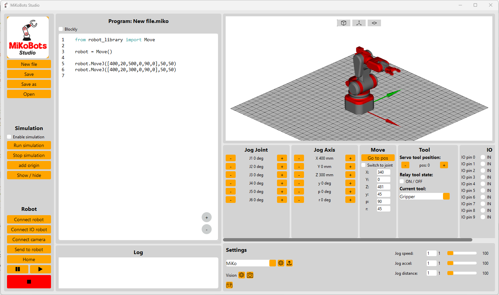

# MiKoBots Studio – ARM version

This folder is MiKoBots Studio V1.15 adapted for the ARM robot in this repository
(XIAO ESP32-S3 + PCA9685, firmware in the repository root).

- **Installing the app:** [INSTALL.md](INSTALL.md), for everyone who gets the installer.
- **Programming the robot:** see [PROGRAMMING.md](PROGRAMMING.md) for all Python commands,
  Blockly blocks and firmware commands ([Polish version](PROGRAMMING.pl.md)).
- **Changes from the original:** the ARM is the only robot, wrist roll and wrist pitch
  (`robot.WristRoll`, `robot.WristPitch`, Blockly blocks, Roll / Pitch jog rows), the simulation
  shows both, a servo test as the example program, Blockly library included, and several fixes
  (running from source, serial boot output, Bluetooth scan crash).

## Run from source

The Python environment lives **outside the repository**, next to it (the firmware folder is an
Arduino sketch, and arduino-cli scans everything inside it):

```powershell
# once, in the folder that contains the repository (Python 3.12):
python -m venv .venv
.venv\Scripts\python -m pip install -r arm\MiKoBots-Studio\requirements.txt pyinstaller

# run
cd arm\MiKoBots-Studio\MiKoBots_Studio\src
..\..\..\..\.venv\Scripts\python main.py
```

## Build the Windows app and installer

```powershell
powershell -ExecutionPolicy Bypass -File arm\MiKoBots-Studio\packaging\build.ps1
```

Needs PyInstaller in the venv and [Inno Setup 6](https://jrsoftware.org/isinfo.php)
(`winget install JRSoftware.InnoSetup`). The result goes to `release\` next to the repository:

- `release\dist\MiKoBots Studio\MiKoBots Studio.exe` – the app, runs from that folder
- `release\Output\MiKoBots Studio ARM setup.exe` – the installer (Start menu, desktop shortcut,
  uninstaller; no admin rights needed)

On first start the app creates `Documents\MyAppData\MiKoBots` with the ARM robot from
`MiKoBots_Studio\assets\MiKoBots_data\MiKoBots.zip`.

---

# Original README

MiKoBots Studio is an opensource project, designed to control diy robot arms. So if you have designed your own robot arm and don't know how to control it, you can use MiKoBots Studio. The software has a lot of features build in to get the maximum out of your robotic arm, like:

* Blockly programming
* Simulation, you can upload the 3d model of your robot arm and simulate it.
* Export and import robot arms, with the software you can easily configure and share your ptofile with others
* Vision control build in the librery that allows you to connect a camera to the software to give your robot eyes
* Bluetooth and usb connectivity
* Add input and output signals



At the moment the following requirements are in place if you want to control your own robot arm.

**Requirements:**
* 6(RRRRRR), 5(RRRRR) or 3(RRR) axis robot arm 
* Type of motor: Stepper motors or servo
* Limit swithes: each joint should have a limit switch to set the home position, except the joints with servo's
* Microcontroller: ESP32, Arduino mega

**Version MiKoBots Studio:**
The current released version and which can be donwloaded on https://mikobots.com/ is: V1.15

**History MiKoBots Studio:**<br>
Version: 1.15<br>
Date: 18-2-2025<br>
* fixed some bugs regarding saving settings, connecting IO

Version: 1.14<br>
Date: 11-1-2025<br>
* added support for arduino mega boards
* besides stepper motor you can also choice out of a servo


Version: 1.13<br>
Date: 7-12-2024<br>
* Fixed a bug, related to connecting the robot to the software

Version: 1.12<br>
Date: 6-12-2024<br>
* Fixed a bug, not able to import new robot

Version: 1.11<br>
Date: 5-12-2024<br>
* More vision function
* Play and pause button for the robot
* Automaticcly closing of the connect windows
* and fixing some bugs that appears in the earlier vesion

Version: 1.1<br>
Date: 9-11-2024<br>
A lot of new updates since version 1.0, the mostimportant updates are:
* Connectivity with bluetooth
* Blockly programming 
* Seperate window for the robot settings
* Available for macOS

Version: 1.0<br>
Date: 1-10-2024<br>
First official release of MiKoBots studio.


**Version MiKoBots firmware:**
The current released version and which can be donwloaded on https://mikobots.com/ is: V1.22